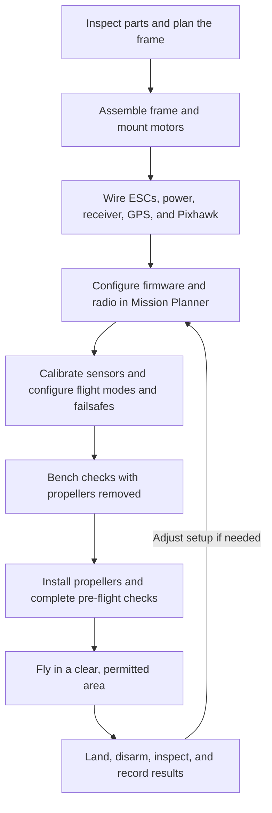
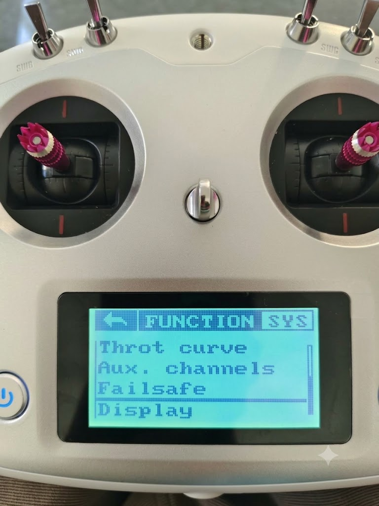
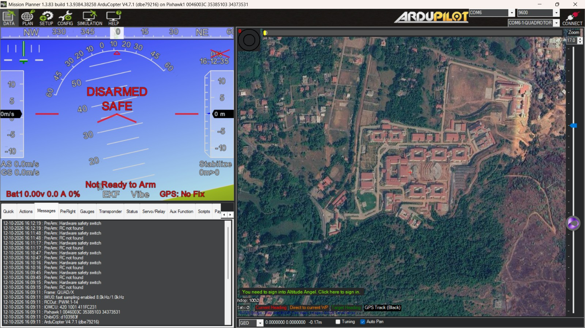
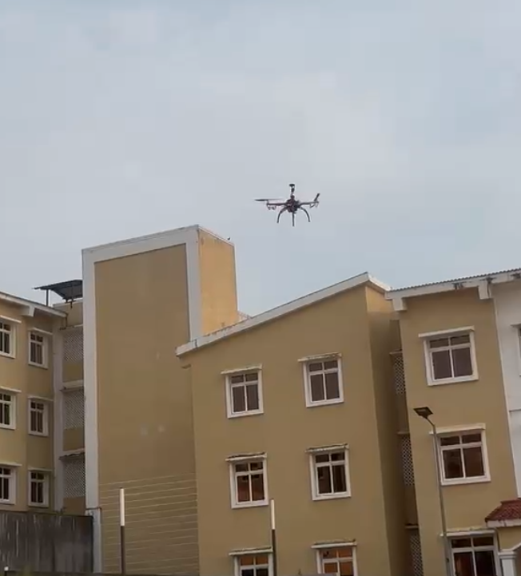

# Quadcopter Drone Project

A Pixhawk-based quadcopter build covering airframe assembly, electrical wiring, flight-controller setup, calibration, and flight testing. The project report contains the detailed build procedure, wiring summary, safety guidance, and troubleshooting notes.

## Hardware

- Pixhawk 2.4.8 flight controller with GPS and external compass
- Four A2212/13T 1000 KV brushless motors and four Cyclone 35 A ESCs
- FlySky FS-i6S transmitter and FS-iA10B receiver, connected using PPM
- 10-inch propellers
- Reported battery: 3-cell, 5200 mAh; verify the battery label and configuration before use

The documented flight modes are Stabilize, Loiter, and Return to Launch (RTL). Mission Planner is used for firmware setup, calibration, battery monitoring, and flight-mode configuration.

## Build and flight workflow

### Assembly and setup

1. Check the frame, motors, ESCs, propellers, battery, Pixhawk, receiver, and GPS for damage; identify each motor position before mounting it.
2. Assemble the frame, mount the motors and flight controller securely, and keep the controller's orientation aligned with the aircraft.
3. Connect each ESC to its motor and the flight controller, then connect the receiver and GPS/compass. Check polarity and connector placement against the hardware documentation before connecting the battery.
4. With propellers removed, connect Mission Planner, install or verify the appropriate firmware, and confirm the receiver channels and transmitter inputs respond as expected.
5. Calibrate the accelerometer, compass, radio, and ESCs as applicable to the installed firmware and hardware. Set and verify flight modes, battery monitoring, and radio/battery failsafes before flight.

### Testing and first flight

Do initial checks with **all propellers removed**: verify sensor health, motor order and rotation, radio response, arming behavior, battery readings, and failsafe actions. Correct any issue before installing propellers; keep clear of the motors during powered tests.

For the first flight, use a suitable open area away from people, roads, buildings, and obstacles. Check the weather, battery condition, GPS/compass status, and RTL behavior and settings. Take off in Stabilize mode, climb to a modest safe height, and first confirm a steady hover and predictable response to small control inputs. Practice only simple movements, keep the aircraft in sight, and land promptly if it behaves unexpectedly or a warning appears. Disarm after landing, disconnect the battery, and inspect the frame, wiring, motors, and propellers before the next flight.

Use the transmitter's configured controls and mode switch as verified in Mission Planner; do not assume channel assignments from another aircraft. Loiter and RTL should only be used after their sensors, mode selection, and return/landing behavior have been checked for the actual site and setup.

## Project photos

| Radio transmitter | Mission Planner |
|---|---|
|  |  |
| Outdoor flight test | Assembled quadcopter |
|  |  |

## Repository contents

- `src/Main.java` — IntelliJ IDEA Java starter/demo program. It is not flight-control firmware.
- [`Drone_Project_Report_Improved (1).docx`](./Drone_Project_Report_Improved%20%281%29.docx) — detailed project report.

The Pixhawk firmware and aircraft configuration are handled through Mission Planner; this repository does not contain custom drone-control software.

## Running the Java demo

Open the project in IntelliJ IDEA, configure a JDK that supports the compact source-file syntax used in `src/Main.java`, and run `Main.java`. The demo prints a greeting and the numbers 1 through 5; running it does not control the quadcopter.

## Drone rules and safety

Follow the drone laws and site restrictions that apply where you fly. Check current registration, pilot competency, operating permission, altitude, airspace, and privacy requirements; rules vary by location and aircraft. Do not fly in restricted airspace or near airports or emergency operations without the required authorization. Respect people and property, maintain visual line of sight where required, and avoid flights over people unless explicitly permitted.

Remove all propellers before ESC calibration and motor testing. Before every flight, verify the aircraft is undamaged, the battery is secure, motor order and rotation are correct, radio and battery failsafes work, sensors and GPS/compass are healthy, and RTL settings are suitable for the flight area. Never fly with uncertain settings or a damaged propeller, and always follow the installed hardware and firmware documentation.
